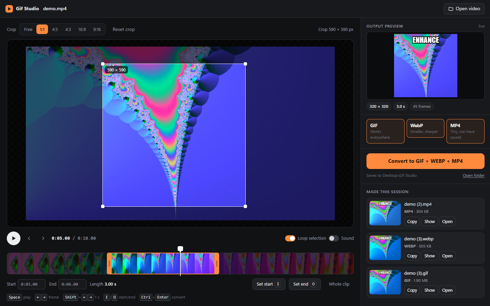

# Gif Studio

**Turn any video into a GIF, WebP or MP4 clip, with a live preview of exactly what you'll get.**

Crop it, trim it, speed it up, add a caption, then press Convert. Everything runs on your own PC: no uploads, no accounts, no watermark.

<p align="center">
  
</p>

**[⬇ Download the latest version](https://github.com/svenni702/gif-studio/releases/latest/download/gif-studio.zip)** · [Website](https://svenni702.github.io/gif-studio/) · [All releases](https://github.com/svenni702/gif-studio/releases)

---

## What it can do

| | |
|---|---|
| **Crop with a live box** | Drag the box or its corners on top of the video. Lock it to 1:1, 4:5, 4:3, 16:9 or 9:16. |
| **Trim on a timeline** | Thumbnail strip with handles for start and end. Drag the selection to move it, or type exact times. The selection loops while you work. |
| **Live output preview** | Shows the result at your size, frame rate, crop, rotation and captions while the video plays. |
| **Size and timing** | Width presets, frame rate, speed from 0.25× to 3×, and Forward / Reverse / Boomerang. |
| **Edit** | Rotate, flip, and meme-style top and bottom captions that shrink to fit. Korean and other non-Latin text works too. |
| **Quality** | Number of colors, dithering style and loop count for GIFs, plus quality for WebP. MP4 can keep the sound. |
| **Three formats at once** | Tick GIF, WebP and/or MP4 and get all of them from one click. |
| **Quick sharing** | **Copy** puts the finished file on the clipboard, so Ctrl+V in Discord or a folder pastes the file itself. It also warns you when a clip is over Discord's 10 MB limit. |

It opens MP4, WebM, MOV, MKV, AVI, GIF and WebP files. Formats Chrome can't play by itself (like MKV or GIF) get a quick preview copy automatically.

<p align="center"></p>

## Getting started (Windows 10 / 11)

1. **[Download the zip](https://github.com/svenni702/gif-studio/releases/latest/download/gif-studio.zip)** and unzip it anywhere, for example on your Desktop.
2. Double-click **`Start Gif Studio.bat`**.
3. The first time, it checks for the two free tools it needs, **Node.js** and **ffmpeg**. If one is missing it offers to install it for you with `winget` (built into Windows). Say yes, then start Gif Studio again.

That's it. Gif Studio opens in its own window. Drop a video in and go.

Finished clips are saved in a **Gif Studio** folder on your Desktop.

> **Prefer to install things yourself?** Node.js: <https://nodejs.org> (LTS). ffmpeg: `winget install Gyan.FFmpeg`, or download it from <https://www.gyan.dev/ffmpeg/builds/> and put `ffmpeg.exe` and `ffprobe.exe` in a folder named `ffmpeg` next to `Start Gif Studio.bat`.

### Keyboard shortcuts

| Key | Does |
|---|---|
| `Space` | Play / pause |
| `←` `→` | Step one frame (hold `Shift` for 1 second) |
| `I` / `O` | Set start / end at the playhead |
| `Home` / `End` | Jump to start / end of the selection |
| `Ctrl` + `Enter` | Convert |
| `Ctrl` + `O` | Open a video |
| `Ctrl` + `V` | Paste a copied video file or a file path |
| Arrow keys on the crop box | Nudge the crop (hold `Shift` for bigger steps) |

## How it works

Gif Studio is two small files plus a launcher:

```
Start Gif Studio.bat  ->  node server.js  ->  opens http://127.0.0.1:47823 in a window
                              |
                              +-- runs ffmpeg on your PC to make previews and clips
```

- **`server.js`** is a tiny web server written for Node.js with no extra packages. It only listens on `127.0.0.1`, which means "this computer", so nothing else on your network or the internet can reach it. It also refuses requests that come from other websites.
- **`index.html`** is the whole interface: the video player, crop box, timeline and settings. It loads nothing from the internet. Fonts come from Windows, so it works offline.
- **ffmpeg** does the real work. When you press Convert, the server runs ffmpeg with your crop, trim, speed and caption settings. GIFs use a two-step palette (`palettegen` + `paletteuse`) for much better colors than a plain conversion.
- When you drop a file into the window, the browser hands the server a copy in your temp folder (`%TEMP%\gif-studio`). Browsers aren't allowed to tell a page where a file really lives. Nothing leaves your PC. Temp files older than a day are cleaned up automatically.
- If Chrome is installed it opens as a clean app window without tabs. Otherwise it opens in your default browser.
- The server shuts itself down about 20 seconds after you close the Gif Studio window.

## Tips for small GIFs

GIF is an old format, and file size grows fast with **width × height × frames**.

- 320–480 px wide and 12–20 fps is the sweet spot for chat apps.
- Fewer colors (64–128) and the **Pattern** dithering style make files smaller.
- The output preview shows the frame count, and warns you when a GIF will be big.
- For long or high-quality clips, **WebP** or **MP4** are far smaller and sharper. Discord shows both inline.

## Troubleshooting

- **"ffmpeg was not found"**: install it (see above), then close Gif Studio and start it again. A new install is only picked up by new windows.
- **"The background server stopped"**: the black console window was closed. Start `Start Gif Studio.bat` again. The open window reconnects by itself and keeps your clip and settings.
- **Port already in use**: run `Start Gif Studio.bat --port 47824` (any free number).
- **Choosing where clips are saved**: run `Start Gif Studio.bat --out "D:\My clips"`.
- Something odd? Unexpected errors are written to `%TEMP%\gif-studio\server.log`.

## For tinkerers

```
node server.js [--open] [--port 47823] [--out "<folder>"] [--ffmpeg "<folder with ffmpeg.exe>"]
```

There's no build step and no dependencies. Edit `index.html` or `server.js` and restart.

## License

[MIT](LICENSE). Do what you like with it. ffmpeg is a separate project with its own license and isn't included here.
